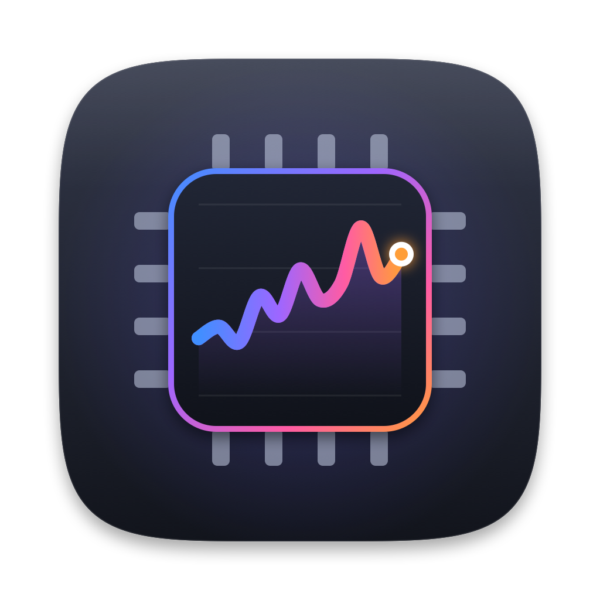

<p align="center">
  
</p>

<h1 align="center">Hardware Monitor</h1>

<p align="center">
  A native, no-root system monitor for macOS, built with SwiftUI.<br>
  Live graphs for CPU, GPU, memory, power, disks and network, plus a configurable menu bar readout.
</p>

---

## Features

- **Overview dashboard** with a health status line, gauges, a power-flow diagram (adapter → system → battery), thermals, throughput, storage and top processes.
- **Per-subsystem panes** for CPU, GPU, Memory, Power, every Disk and every Network adapter, each with a live time-series graph and detailed stats.
- **Apple silicon aware**: per-cluster CPU frequency, frequency-weighted GPU utilisation, and per-component power (CPU, GPU, Neural Engine, DRAM) from the same counters `powermetrics` uses, without needing root.
- **Temperatures** from the on-die sensors (performance/efficiency cores, GPU, SoC, SSD, battery).
- **Battery and charger details**: health, cycle count, charge/discharge power, and the USB-C PD profiles your charger offers.
- **Menu bar readout**: pick any of CPU, GPU, memory pressure, CPU temperature, system power, battery, network or disk activity. Cells are fixed-width, so the status item never jiggles.
- **Compact mode and Keep on Top**: shrink a single pane into a small floating window.
- **Freeze with Space**: pause every graph and value to inspect a spike while sampling carries on underneath.
- **1 minute, 5 minute or 1 hour** graph ranges, from a one-second sampling history.

See [docs/features.md](docs/features.md) for the full tour.

## Requirements

- A Mac running **macOS 27** or later (the project's deployment target)
- **Xcode 27** to build
- Apple silicon is the primary target. Intel Macs run, but without the IOReport-based power and frequency data.

## Build and run

```sh
git clone https://github.com/Antoinenz/hwmonitor.git
cd hwmonitor
open "Hardware Monitor.xcodeproj"
```

Then press **⌘R** in Xcode. Or from the command line:

```sh
xcodebuild -project "Hardware Monitor.xcodeproj" \
           -scheme "Hardware Monitor" \
           -configuration Release \
           -derivedDataPath build \
           build
open "build/Build/Products/Release/Hardware Monitor.app"
```

More detail, including signing, in [docs/getting-started.md](docs/getting-started.md).

## Keyboard shortcuts

| Shortcut | Action |
| --- | --- |
| `Space` | Freeze or resume the graphs |
| `⌘1` `⌘2` `⌘3` | 1 minute, 5 minute or 1 hour graph range |
| `⌥⌘C` | Toggle compact mode |
| `⌥⌘T` | Toggle keep on top |
| `⌘O` | Open the main window (from the menu bar panel) |
| `⌘,` | Settings |
| Double-click a sidebar row | Jump into compact mode on that pane |

## How it works

Hardware Monitor samples once per second on a wall-clock-aligned tick and keeps the last hour in memory. Nothing is written to disk and nothing leaves your Mac. Readings come straight from the system: Mach host APIs, the IORegistry, the SMC, IOReport, the IOHID sensor system and the kernel's network counters.

Because it reads private system interfaces (IOReport, IOHIDEventSystem) and runs without the App Sandbox, it can't be distributed through the Mac App Store. See [docs/architecture.md](docs/architecture.md) and [docs/data-sources.md](docs/data-sources.md).

## Documentation

| Document | What's in it |
| --- | --- |
| [docs/getting-started.md](docs/getting-started.md) | Requirements, building, running, signing |
| [docs/features.md](docs/features.md) | Every pane, the menu bar, compact mode, settings |
| [docs/architecture.md](docs/architecture.md) | Sampling pipeline, state, and view structure |
| [docs/data-sources.md](docs/data-sources.md) | Where every number comes from |
| [docs/development.md](docs/development.md) | Project layout, adding a metric, regenerating the icon |

## Project layout

```
Hardware Monitor/
├── Hardware Monitor/          App source
│   ├── MyApp.swift            App entry: window, menu bar extra, settings, commands
│   ├── ContentView.swift      Sidebar + detail split view, compact mode
│   ├── Model/                 Sample types, formatting, preferences
│   ├── Services/              Hardware readers and the sampling loop
│   ├── Views/                 Panes, sidebar, menu bar panel, settings, components
│   └── Assets.xcassets/       App icon and accent colour
├── docs/                      Documentation
├── Tools/make-icon.swift      Regenerates the app icon
└── Hardware Monitor.xcodeproj
```

## License

[MIT](LICENSE) © 2026 Antoine Rossi
